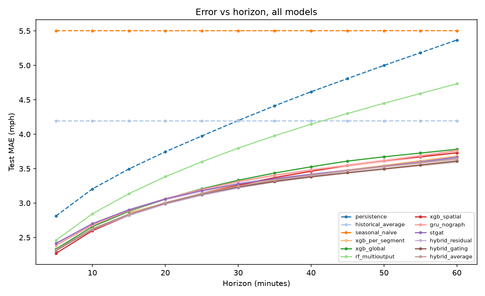

# Traffic Flow Prediction & Simulated Control on METR-LA

Graph attention networks vs. segment-level machine learning for 5-60 minute speed forecasting on the METR-LA freeway sensor network, plus a leakage-safe ML+graph hybrid and an *offline simulated* ramp-metering study. Full specification: [SPEC.md](SPEC.md); build plan: [phases/](phases/00_OVERVIEW.md); decisions: [docs/decisions.md](docs/decisions.md).

> Control experiments are offline simulations on a synthetic network. No live or real-world traffic control is performed or claimed.



## Team T042 (ordered by difficulty and technical depth of the work owned)
| Member | Owns |
|---|---|
| **Pranav Singh** | Deep-learning core: GAT layer, STGAT, GRU baseline, trainer |
| **Kunal** | Phase 1 ML (features, XGBoost, Random Forest, tuning, SHAP, gap analysis) and the hybrid models |
| **Himanshu** | Evaluation and statistics, baselines, simulated control |
| **Kanchan** | Data pipeline, graph, missing data, EDA, ablation runs |
| **Vaibhav** | Scaffold/CI, maps and attention plots, README/slides, report assembly |

Details, module lists, report sections and viva files: [CONTRIBUTIONS.md](CONTRIBUTIONS.md), [docs/viva/](docs/viva/). **Team members: after cloning, run `python3 join.py` and you are done** ([docs/TEAM_WORKFLOW.md](docs/TEAM_WORKFLOW.md)).

## Reproduce
```bash
uv venv --python 3.11 .venv && source .venv/bin/activate
uv pip install -e ".[dev]"         # or: pip install -r requirements.txt
make data      # download METR-LA + DCRNN graph files, verify, write MANIFEST.json
make eda       # figures + docs/eda_summary.md
make phase1    # baselines + evaluation tables
bash scripts/run_ml_chain.sh       # tune + train the 4 ML models
bash scripts/run_dl_chain.sh       # GRU-nograph and STGAT, 3 seeds
bash scripts/run_phase2_chain.sh   # OOF, hybrids, evaluation, maps, control, report assets
bash scripts/run_ablation_chain.sh # reduced-budget ablations
make test      # unit + (if data present) end-to-end debug tests
```
`--debug` flags on the training scripts run a tiny CPU config. Everything auto-detects the device (CUDA, Apple MPS, CPU).

## Hardware and runtimes (this run)
MacBook with Apple M3 Pro (11 cores, 18 GB), run at low priority with 6 CPU cores / 4 torch threads and the MPS GPU. Approximate wall-clock: ML chain ~50 min; GRU-nograph ~8 min/seed; STGAT ~28 min/seed (40 epochs); OOF + hybrids ~80 min; ablations ~3-4 h. Exact timings per run are in [docs/experiment_log.md](docs/experiment_log.md). The budgets were deliberately reduced for a laptop (see ADR-006/007), so absolute numbers are not tuned to the limit.

## Where things are
- `src/traffic/` library code; `scripts/` entry points; `configs/` YAML; `tests/`
- `results/metrics/` all CSVs (committed); `results/figures/`, `results/maps/` (interactive HTML)
- `report/phase1`, `report/phase2` IEEE reports (numbers come from `report/tables/numbers.tex`, generated)
- `docs/` EDA summary, theory notes (`docs/theory/`), viva prep (`docs/viva/`), ADRs

## Results
<!-- RESULTS_START -->
### Test error by horizon (mph, masked)

| model | MAE@15min | MAE@30min | MAE@60min | RMSE@15min | RMSE@30min | RMSE@60min | MAPE@15min | MAPE@30min | MAPE@60min |
|---|---|---|---|---|---|---|---|---|---|
| gru nograph | 2.89 | 3.31 | 3.76 | 5.62 | 6.66 | 7.71 | 7.83 | 9.67 | 11.53 |
| historical average | 4.19 | 4.19 | 4.19 | 7.86 | 7.86 | 7.86 | 13.06 | 13.06 | 13.06 |
| hybrid average | 2.84 | 3.25 | 3.64 | 5.53 | 6.51 | 7.39 | 7.69 | 9.51 | 11.32 |
| hybrid gating | 2.84 | 3.23 | 3.61 | 5.52 | 6.45 | 7.34 | 7.68 | 9.38 | 11.03 |
| hybrid residual | 2.82 | 3.22 | 3.65 | 5.46 | 6.45 | 7.46 | 7.51 | 9.18 | 11.22 |
| persistence | 3.49 | 4.20 | 5.37 | 6.39 | 8.02 | 10.30 | 8.60 | 10.83 | 14.48 |
| rf multioutput | 3.14 | 3.80 | 4.73 | 5.70 | 6.89 | 8.25 | 8.50 | 10.87 | 14.27 |
| seasonal naive | 5.50 | 5.50 | 5.50 | 10.71 | 10.71 | 10.71 | 15.57 | 15.57 | 15.57 |
| stgat | 2.90 | 3.28 | 3.67 | 5.52 | 6.48 | 7.44 | 7.76 | 9.41 | 10.97 |
| xgb global | 2.88 | 3.33 | 3.78 | 5.69 | 6.80 | 7.76 | 7.87 | 9.90 | 12.11 |
| xgb per segment | 2.86 | 3.28 | 3.68 | 5.60 | 6.62 | 7.52 | 7.92 | 9.77 | 11.65 |
| xgb spatial | 2.82 | 3.26 | 3.73 | 5.46 | 6.54 | 7.54 | 7.63 | 9.53 | 11.82 |

### MAE at 60 min by slice (mph)

| model | offpeak_weekday | peak | peak_am | peak_pm | weekend |
|---|---|---|---|---|---|
| gru_nograph | 3.18 | 5.43 | 4.53 | 6.27 | 3.07 |
| historical_average | 3.51 | 6.06 | 4.93 | 7.13 | 3.50 |
| hybrid_average | 3.07 | 5.25 | 4.35 | 6.09 | 3.00 |
| hybrid_gating | 3.07 | 5.14 | 4.29 | 5.95 | 2.99 |
| hybrid_residual | 3.08 | 5.28 | 4.48 | 6.03 | 2.98 |
| persistence | 4.85 | 7.45 | 6.93 | 7.95 | 3.98 |
| rf_multioutput | 3.82 | 7.24 | 6.52 | 7.91 | 3.80 |
| seasonal_naive | 4.37 | 7.48 | 6.18 | 8.70 | 5.83 |
| stgat | 3.13 | 5.19 | 4.35 | 5.98 | 3.05 |
| xgb_global | 3.11 | 5.65 | 4.67 | 6.58 | 3.05 |
| xgb_global_daily | 3.12 | 5.67 | 4.69 | 6.59 | 3.04 |
| xgb_per_segment | 3.11 | 5.26 | 4.19 | 6.28 | 3.09 |
| xgb_spatial | 3.08 | 5.54 | 4.65 | 6.38 | 3.03 |
<!-- RESULTS_END -->
