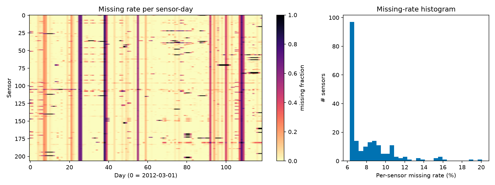
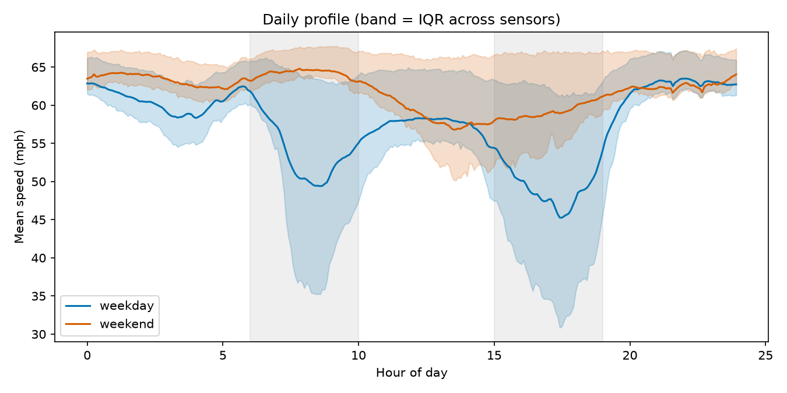
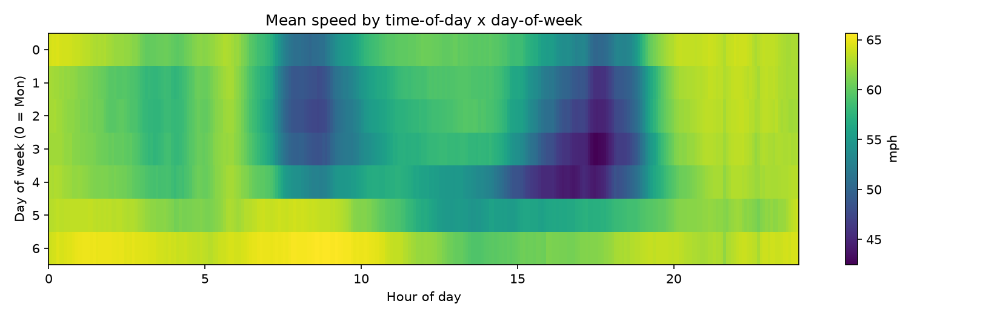
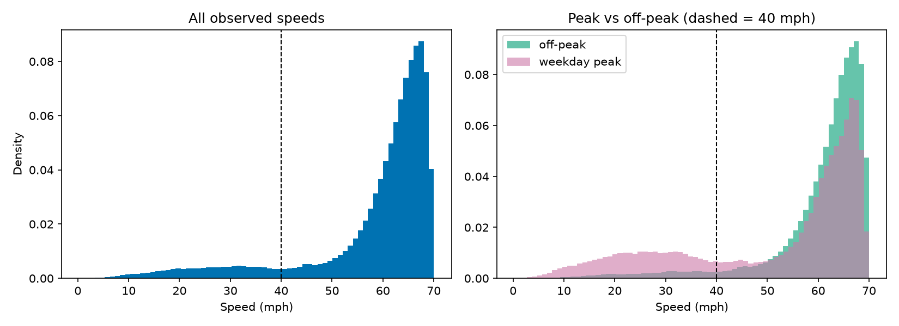
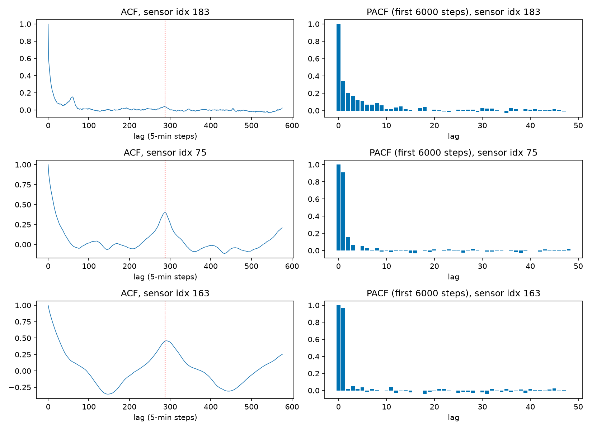
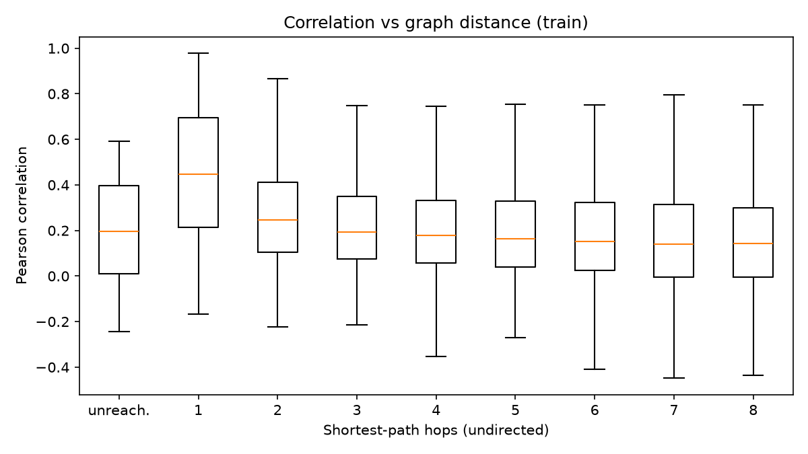
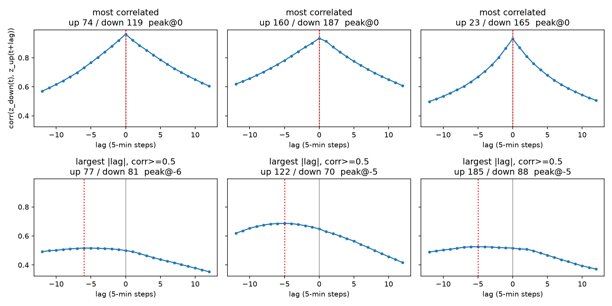
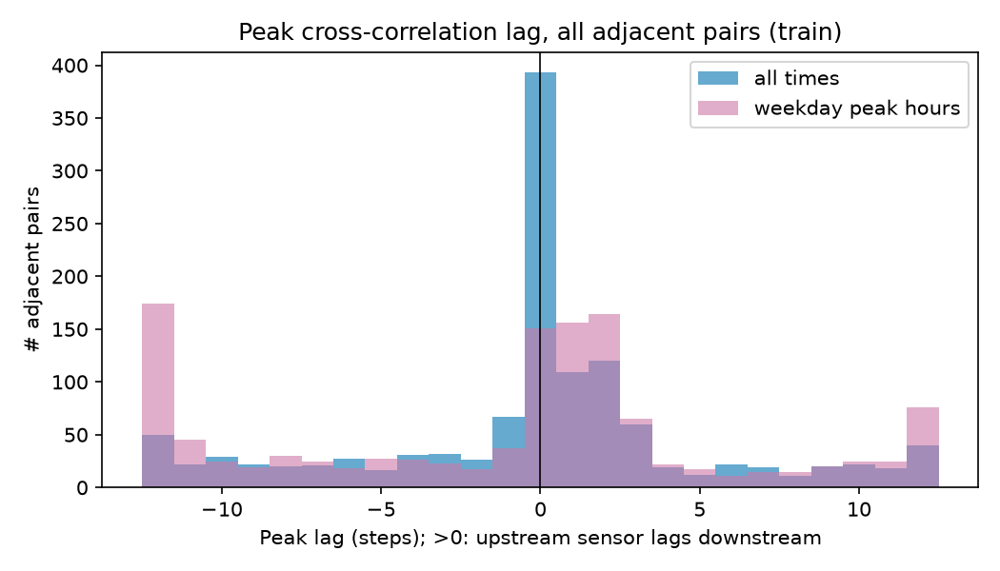
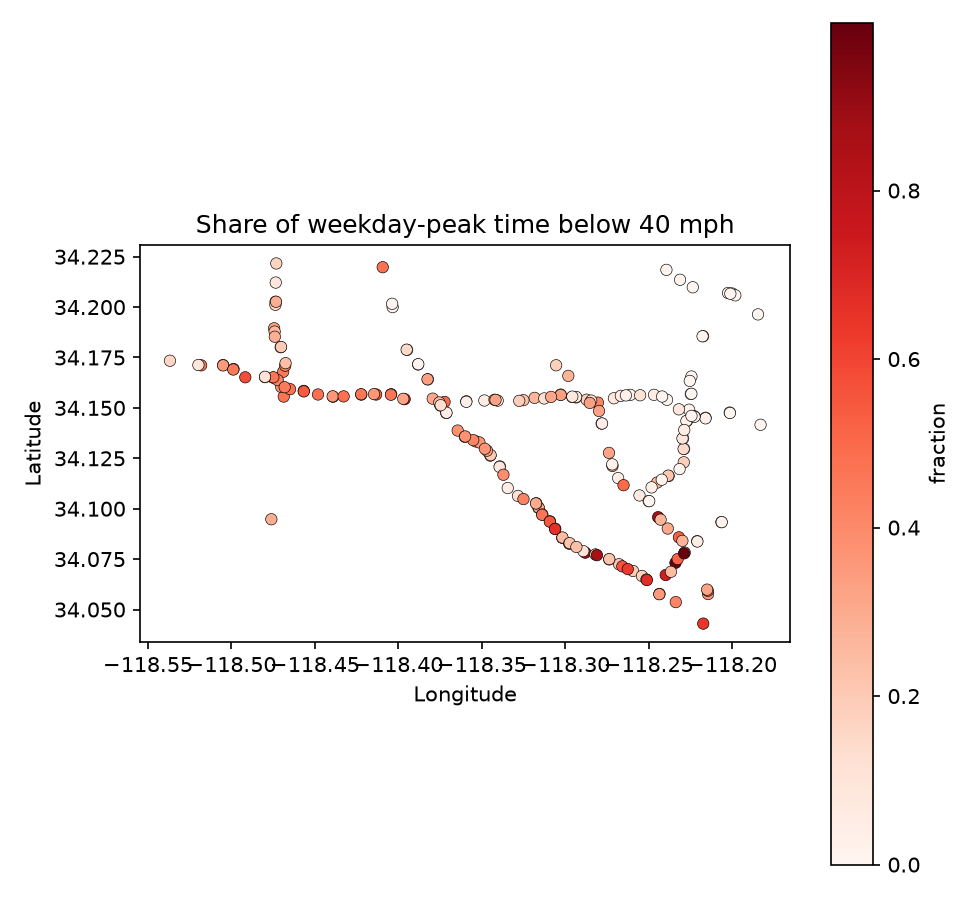
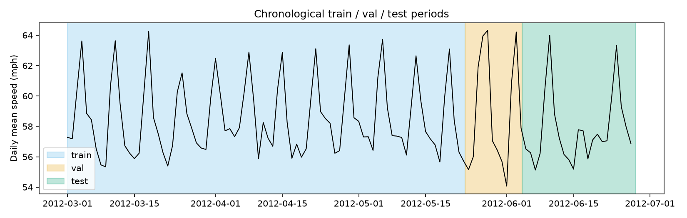

# EDA summary (auto-generated by `scripts/make_eda_summary.py`)

All numbers come from `results/metrics/eda_stats.json`. Figures are descriptive ("all data")
except 5, 6, 7 which use the **train** period only because they inform modeling.

## 1. Missingness — 
8.1% of readings are 0 (outage, not stopped traffic). Per-sensor rates have a median of
7.0% and a maximum of 20.1%; no sensor is always present.
2148 timestamps have >=90% of sensors missing at once (network-wide outages), so missingness is
partly clustered in time, not only per sensor. Hence: masked losses and metrics, and an `is_missing` input channel.

## 2. Daily profile — 
Weekday mean speed bottoms out at 45.3 mph around hour 17.5; weekends only drop to
56.8 mph (hour 13.5). Weekday and weekend patterns differ, so day-of-week features matter.

## 3. Time-of-day x day-of-week — 
Mean speed ranges from 42.5 to 65.7 mph across the week, with congestion confined to weekday rush hours.

## 4. Speed distribution — 
Overall mean 58.5 mph. 10.9% of observations are below 40 mph overall, but
26.9% during weekday peaks versus 5.8% off-peak. Congested states are the minority class and dominate errors, which is why peak and congested slices are reported separately.

## 5. ACF / PACF — 
Autocorrelation at the daily lag (288) for three representative sensors is 0.03, 0.40 and 0.45
(low / median / high variance). Daily seasonality exists but its strength differs by sensor; the series are strongly autocorrelated at short lags (PACF), which is why a 12-step history works and why windows from nearby times are not independent (a reason for chronological splits and HAC significance tests).

## 6. Correlation vs graph distance — 
Median pairwise correlation falls from 0.45 at 1 hop to 0.25 at 2 hops and
0.14 at 8 hops. Neighbors are clearly more informative than distant sensors, which supports using the road graph.
("Unreachable" pairs all involve the single isolated sensor; their median is 0.20. Even distant sensors correlate because they share the daily cycle.)

## 7. Lagged cross-correlation (propagation evidence) — , 
Convention: a positive peak lag means the **upstream** sensor changes *after* the downstream one (congestion moving upstream).
Across all 1228 adjacent pairs (detrended by the train time-of-day mean), the peak lag is positive for
38%, zero for 32% and negative for 30% (median 0).
Restricted to weekday peak hours: 50% positive, 12% zero, 38% negative.

**Honest reading:** the evidence is real but modest. The strongest pairs peak at lag 0 (adjacent sensors are almost simultaneous at 5-minute resolution),
and during peaks there is an excess of positive over negative lags, consistent with upstream-moving congestion, but many pairs show the opposite sign
and the lag curves are flat. This supports *spatial dependence* clearly (figure 6) and *directional propagation* only weakly. The graph model's gain should
therefore be tested empirically, not assumed. The 6 example pairs in figure 7 are chosen by stated rules (top correlation; largest non-zero lag among corr>=0.5), not by eye.

## 8. Sensor map — `results/maps/eda_sensors.html`
Interactive map with mean-speed and missing-rate layers.

## 9. Congestion frequency — 
The median sensor is below 40 mph for 27% of weekday peak time; 119 sensors exceed 20%,
and the worst is congested 100% of the time. Interactive version: `results/maps/eda_congestion_frequency.html`.

## 10. Split timeline — 
| split | weekday share | peak share | missing rate | mean speed (mph) |
|---|---|---|---|---|
| train | 0.712 | 0.237 | 0.071 | 58.6 |
| val | 0.664 | 0.220 | 0.070 | 58.9 |
| test | 0.748 | 0.252 | 0.121 | 57.8 |

The splits have comparable weekday/peak mixes, but the **test period has a much higher missing rate** than train/val
(more outages), and it includes the end of June. Metrics are masked, so this does not bias them, but results on test are computed over fewer observations.

## Implications for modeling
- Mask zeros everywhere (loss, metrics, targets); give inputs an `is_missing` channel; impute inputs with train-only statistics.
- H = 12 (60 min) is reasonable given short-lag autocorrelation; the daily lag (288) is an optional extra, kept off in the main comparison.
- Report peak, off-peak, weekend and congested slices separately, since congestion is rare overall but frequent at peaks.
- The graph helps in principle (figure 6) but directional propagation evidence is weak, so expect modest, horizon-dependent gains and test them (gap analysis, ablations).
- Watch the test-period outage rate when reading per-sensor results.
