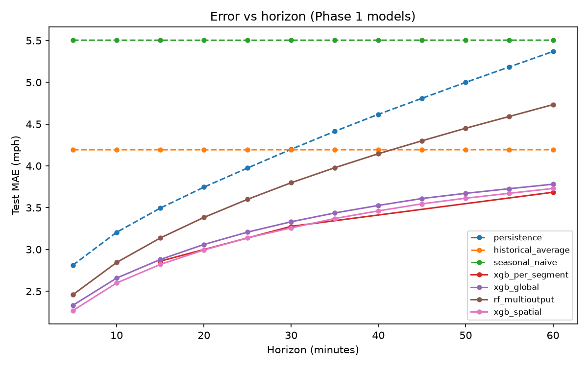
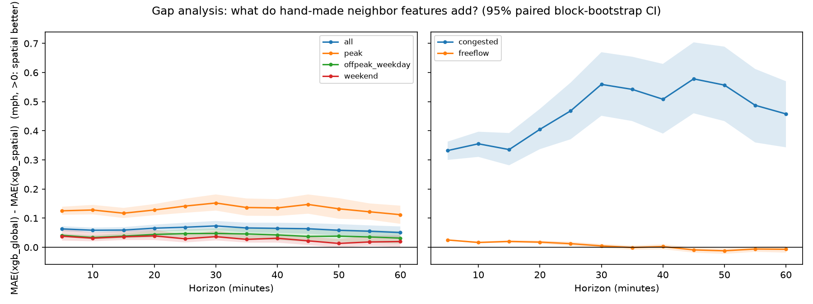
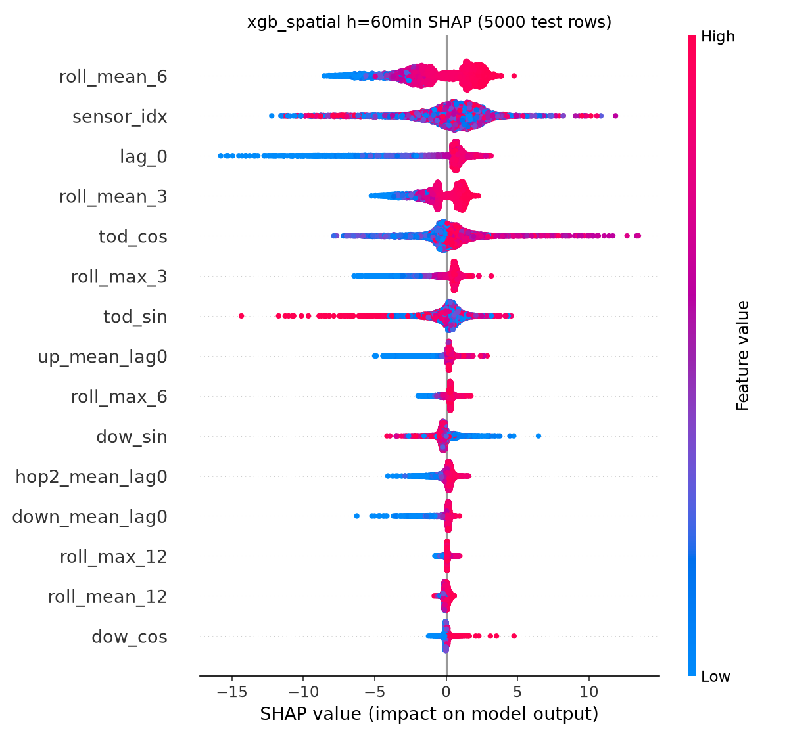

<!-- Figures live in results/figures; numbers are in report/tables/numbers.tex and results/metrics/*.csv. -->

# Traffic forecasting on METR-LA — Phase 1 (ML)
Team T042: Pranav Singh, Kunal, Himanshu, Kanchan, Vaibhav
Segment-level machine learning and the case for graph models

<!-- Speaker note: state the question — does neighbour information help? -->

---
# Problem and hypothesis
- Forecast speed 5–60 min ahead for 207 freeway sensors
- Hypothesis: congestion propagates upstream, so neighbours help — most at long horizons and peaks
- Phase 1 tests how far per-segment ML goes

---
# Data facts
- Speed only (no flow/occupancy); 5-min steps, 4 months
- **0 mph = outage, not traffic** → masked loss/metrics
- Directed road graph from DCRNN distances

---
# Missingness
- ~8% zeros; whole-network outages exist; test period has more outages

---
# Is there propagation? (honest)
- Correlation falls with graph distance → neighbours informative
- Directional lag evidence: modest (more positive than negative lags at peak, many pairs at lag 0)

---
# Features
- Lags, rolling stats, differences, missing flags, cyclic time, static sensor info
- XGB-spatial: upstream/downstream neighbour speeds, 2-hop mean

---
# Models
- Baselines: persistence, historical average, seasonal naive
- XGBoost: per-segment, pooled; Random Forest (multi-output); XGB-spatial

---
# Protocol: no leakage
- Chronological 70/10/20; windows built inside each split
- Scaler, imputation, historical table: train only
- Tuning on validation only; test touched once
- DM test (HAC) + day-block bootstrap

---
# Main results

<!-- Table: results/metrics/main_table.csv -->

---
# Gap analysis

- Neighbour features help, mostly at peaks / congestion; gain does not grow with horizon

---
# What drives the models (SHAP)

---
# Limitations and Phase 2
- One city/season, speed only, fixed graph, reduced tuning budget
- Phase 2: STGAT, no-graph GRU ablation, residual hybrid, ablations, maps, simulated control
