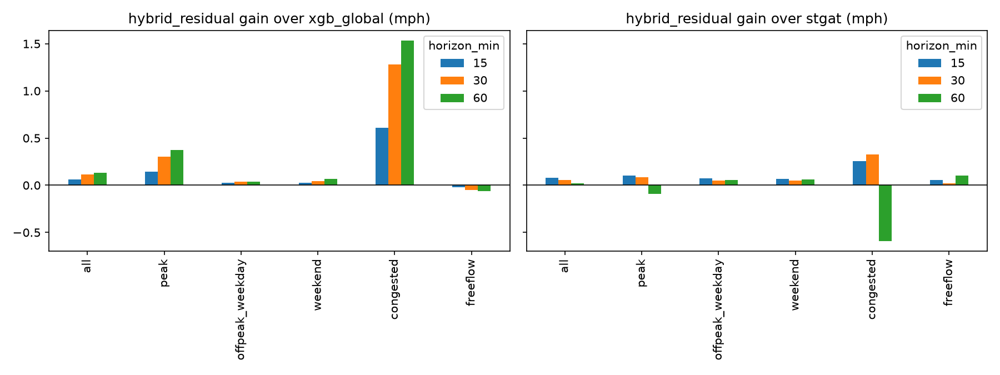
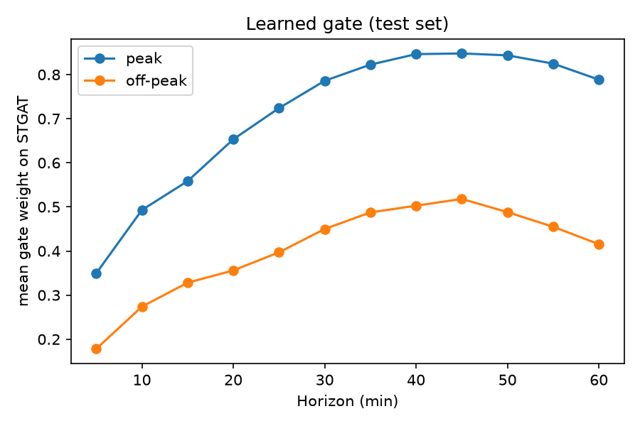
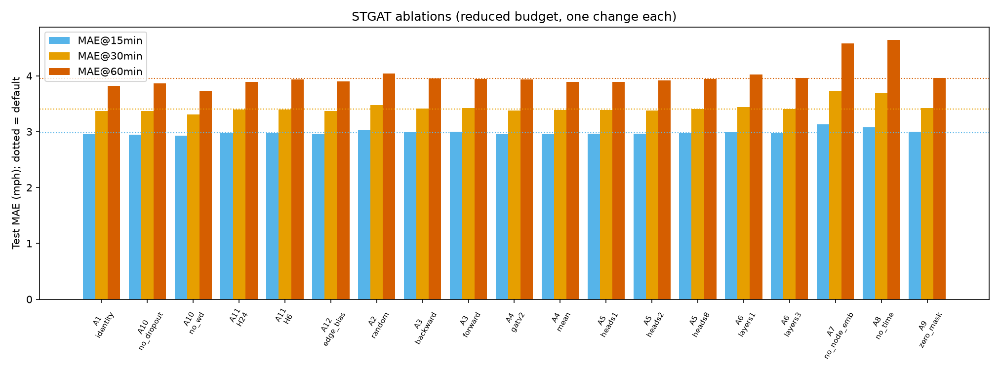
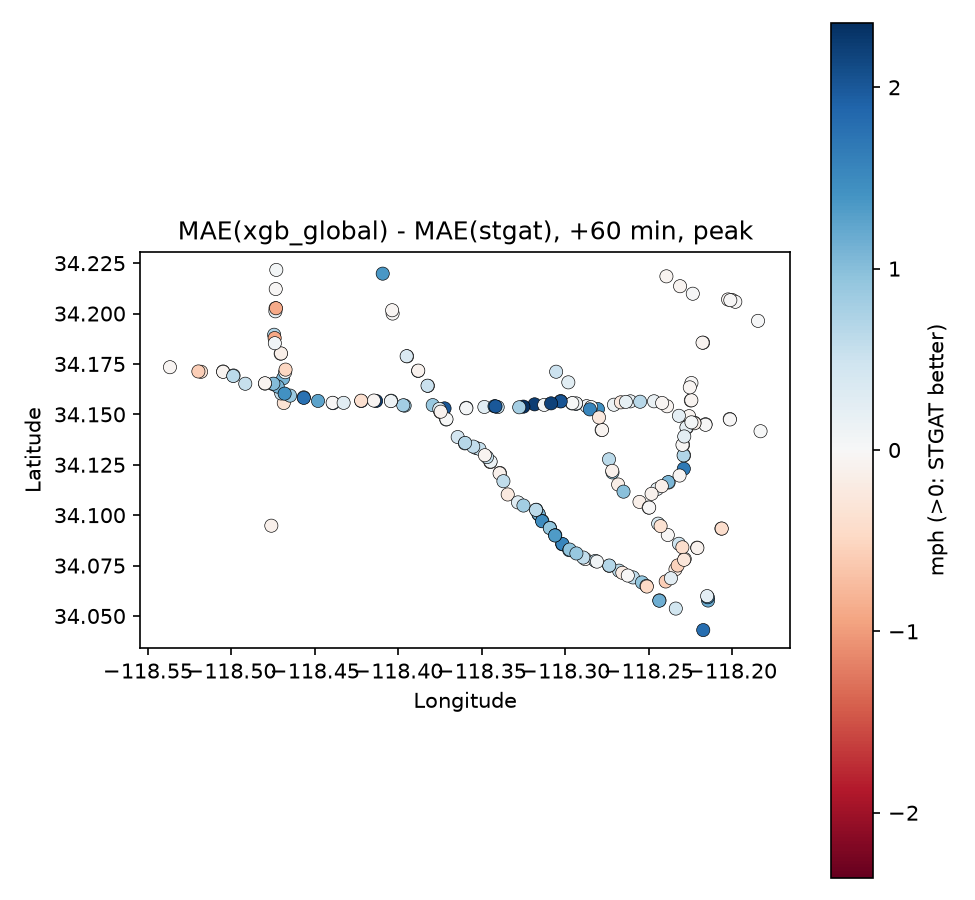
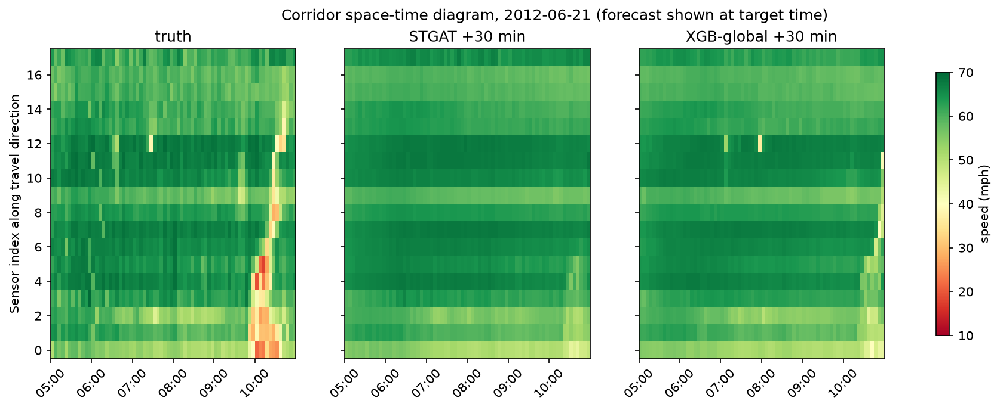
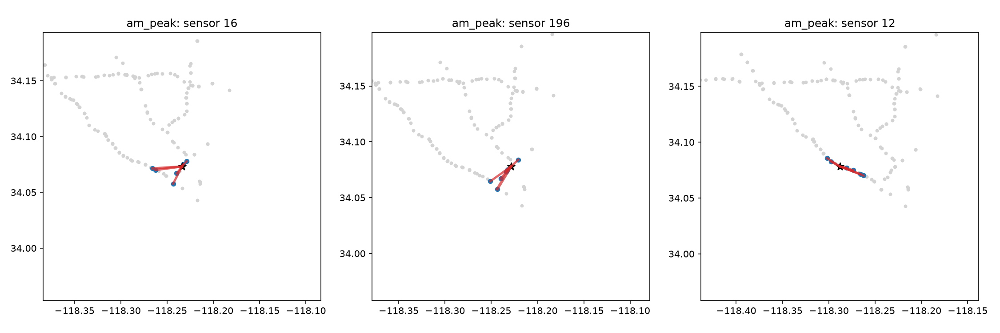
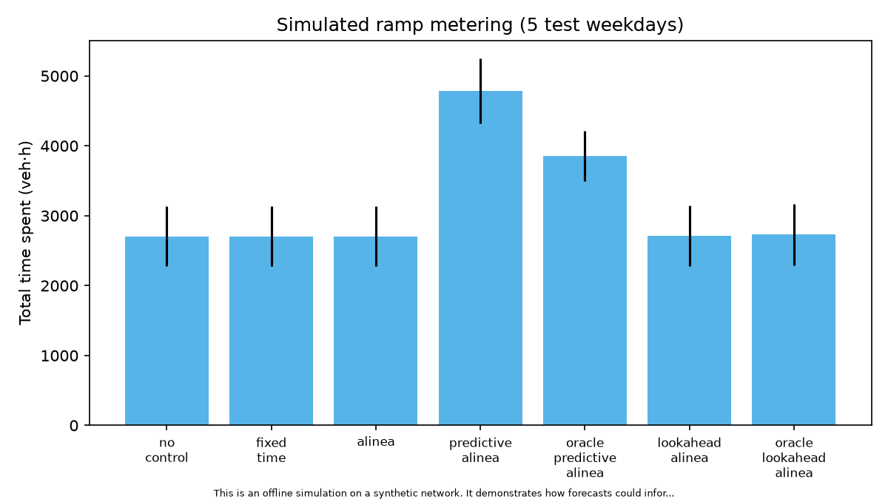

<!-- Numbers: results/metrics/*.csv and report/tables/numbers.tex. Control slides carry the simulation disclaimer. -->

# Phase 2 — Graph attention vs per-segment ML on METR-LA

---
# Recap and hypothesis
- Phase 1: strong per-segment XGBoost; neighbour features help modestly, mostly at peaks/congestion
- Hypothesis: a learned graph model helps most at long horizons and in peaks

---
# STGAT
- Embed → node embedding → 2 × [gated causal TCN → multi-head GAT → residual + LayerNorm] → MLP → 12 horizons
- Own dense GAT layer, **numerically equal to PyG** (tests); neighbour-list version for speed
- Laptop-friendly: GAT on last 4 steps, epochs on a random third of windows

---
# GAT in one slide
- e_ij = LeakyReLU(aᵀ[Wh_i‖Wh_j]), α = softmax over neighbours (mask = adjacency), h'_i = Σ α_ij W h_j
- vs GCN (fixed weights), GATv2 (dynamic attention)

---
# The key control: GRU with no graph
- Same inputs/width/decoder, no spatial layers
- Graph effect only at 60 min (STGAT 3.67 vs GRU 3.76); equal at 15 min

---
# Main results (test)
<!-- Table: results/metrics/main_table.csv -->
- STGAT beats persistence at all horizons
- Per-segment XGBoost remains very competitive
- Hybrids are best

---
# Hybrid: residual with out-of-fold base
- Why OOF: in-sample XGBoost residuals are unrealistically small
- Forward-chaining over 5 train blocks, gap H+F−1, block 1 dropped
- Zero-initialised head → starts exactly at XGBoost

---
# Learned gate
- Trusts STGAT more at peaks and long horizons

---
# Significance
- Diebold–Mariano with HAC variance; all hybrids beat XGBoost-global at all horizons
<!-- Table: report/tables/significance.tex -->

---
# Ablations (reduced budget, 1 seed)

---
# Where does the graph help?

- Gains cluster on specific freeway segments

---
# Space-time view

- Neither model anticipates the abrupt breakdown

---
# Attention (qualitative)
- Upstream/downstream shares identical at AM peak and night → no peak-specific shift found

---
# Simulated ramp metering — **offline simulation, synthetic network, no real-world control**
- ALINEA cuts mainline congestion; total time spent unchanged (delay moves to ramps)
- Forecast variants gave no measurable benefit

---
# Limitations
- One city/season, speed-only, reduced budgets, 1-seed ablations, synthetic control demand

---
# Conclusion
- Graph helps at long horizons / congestion, modestly
- Best: hybrids (residual short-range, gate long-range)
